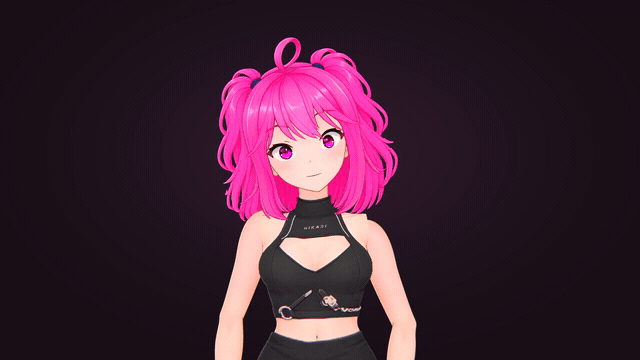
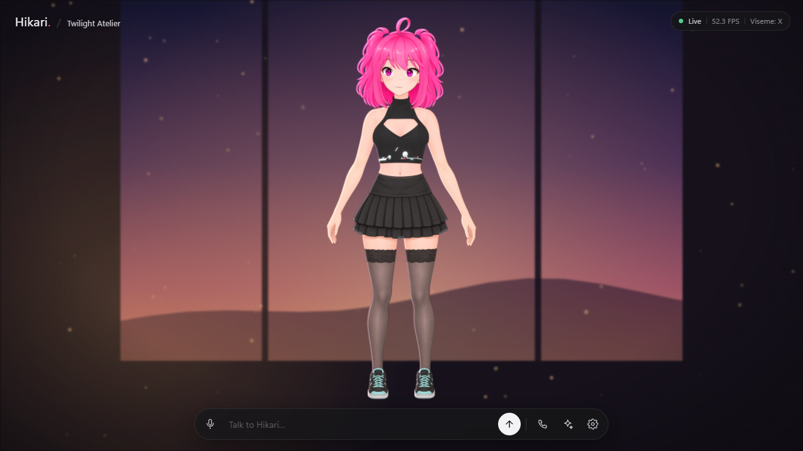
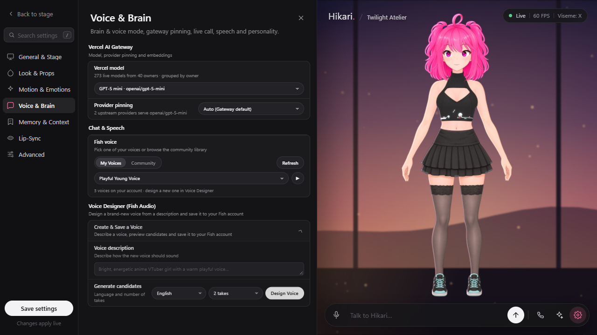
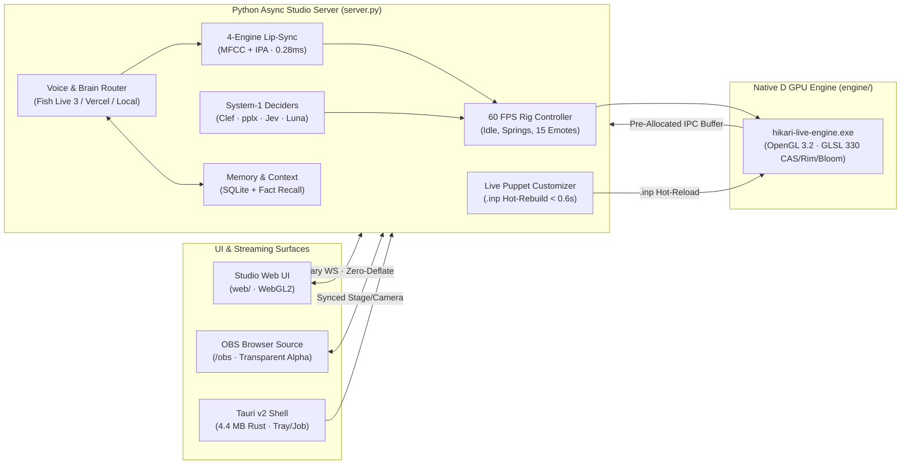

<div align="center">

# Hikari Studio

**Flagship 60 FPS 2.5D Inochi2D AI VTuber Platform**

*Native DLang OpenGL GPU renderer · 4-Engine MFCC + IPA Lip-Sync · Fish Audio Live 3 & Vercel AI Gateway · Persistent SQLite Memory · 4.4 MB Rust/Tauri Desktop App*

[](docs/media/hikari-demo.mp4)
[](#performance--footprint)
[](desktop-tauri/)
[](engine/source/app.d)
[](skills/inochi2d-puppet-builder/SKILL.md)

<br />



<p>
  <sub>Live studio capture with procedural idle, a Midori-style continuous-skin wave, Starry Awe, and Cat Smug. <a href="docs/media/hikari-demo.mp4">Watch full 1280×720 H.264 video →</a></sub>
</p>

</div>

---

## Product Preview

<table>
  <tr>
    <td width="50%">
      
      <p align="center"><sub><b>Full-Stage Mode</b> — zero-clutter viewport with bottom talk/call/emote bar & OBS transparent alpha output</sub></p>
    </td>
    <td width="50%">
      
      <p align="center"><sub><b>Left-Docked Studio Settings</b> — Voice &amp; Brain with the Fish voice picker, Voice Designer, and Vercel model and provider controls</sub></p>
    </td>
  </tr>
</table>

---

## Why Hikari Studio?

Most AI VTuber stacks glue together heavy Electron apps, paid proprietary Live2D runtimes, single-slider jaw flaps, and stateless LLM prompts. **Hikari Studio** is engineered from the ground up as a lean, modular, open-format 2.5D streaming studio:

- **Native 60 FPS DLang GPU Renderer (`engine/source/app.d`):** OpenGL 3.2 + GLSL 330 Inochi2D engine with zero-copy FBO post-processing (Contrast-Adaptive Sharpening, dual rim-lighting, selective specular bloom, room ambient light-wrap, color grading) and **zero per-frame GC allocations**.
- **4-Engine VTS / VBridger Lip-Sync (`modules/lipsync.py`):** Hybrid **12-MFCC + IPA F1/F2 Formants** (`0.28 ms/frame`), standalone uLipSync-style MFCC, IPA Formants, and Classic Amplitude driving an **8-parameter VTS Mouth Mapper** (`jawOpen`, `mouthOpen`, `mouthForm`, `mouthFunnel`, `lipsPress`, `mouthShrug`, `mouthX`, `tongueOut`) with per-voice vowel calibration.
- **Real-Time Voice & Multi-Brain Routing:**
  - **Fish Audio Real-Time Duplex (`Drama 3` / `Live 3`)** full-duplex WebRTC calls with instant STT & 60 FPS lip-sync.
  - **Vercel AI Gateway + Fish Speech SSE/WS/HTTP** with live model and provider pinning dropdowns, fallback models, and server-side key isolation.
  - **Fish Audio Voice Designer** creates and previews voices from a description, with a live dropdown for account and community voices.
  - **Unified Vercel AI Gateway System-1 Deciders (`modules/decision_engine.py`):** Ported straight from Waifu Studio's `evaluation.rs` — pick any live `type: evaluation` model via one single `AI_GATEWAY_API_KEY` (`perplexity/pplx-decider-flash-v1.3`, `openai/gpt-6-luna-decisions`, `typesafe-ai/jev`, `google/gemini-decision-1`, `microsoft/decision-1.1`, `liquid/d1.2`) with automatic Jev fallback and optional direct Cloudflare Clef / Perplexity / OpenAI overrides.
- **Procedural Life & 15 Spring-Tweened Emotes:** Neuro-style autonomous idle choreographer (`curious_tilt`, `vibe_sway`, `happy_bounce`, `chat_read`, `daydream_sigh`, `cheeky_lean`), **Midori-style single-mesh continuous-skin deform arms**, and 15 one-click or AI-triggered emotes. The Decision Model decides whether to wave and when to play it (now, on reply, or after a beat).
- **Universal Puppet Library:** Load Inochi2D `.inp` puppets, import Live2D models through MINT, and feed auto-discovered rig abilities to the Decision Model.
- **Motion Lab:** A pure-motion video tracker captures 20 channels while leaving lip-sync under the voice pipeline’s control.
- **Persistent Memory & Context:** SQLite preserves conversation continuity across restarts, and Waifu Studio–style fact memory recalls relevant details. Manage both in the [Memory & Context panel](docs/media/studio-memory.png).
- **4.4 MB Rust + Tauri v2 Desktop App (`desktop-tauri/`):** System tray, Always-on-Top, frameless transparent OBS window, and Windows Job Object process cleanup so closing the app cleanly shuts down every child process.

---

## Curating Inochi2D Puppets with AI Agents (Skill & Guide)

We built Hikari's entire `.inp` puppet (`v1` → `v28` → HD customizer) programmatically using **AI coding agents (Codex, Claude, Antigravity) + image generation + Python** — zero manual Live2D Cubism required.

- **Human Guide:** [**How We Built & Curated a 60 FPS Inochi2D VTuber with AI Agents**](docs/INOCHI2D_AI_WORKFLOW.md) — covers `.inp` binary structure, premultiplied alpha rules, VRM GLB eye extraction, the original wave rig, skin-safe HSV wardrobe pipelines, and automated visual QA.
- **Portable AI Agent Skill:** [**`skills/inochi2d-puppet-builder/SKILL.md`**](skills/inochi2d-puppet-builder/SKILL.md) — drop straight into **Codex CLI, Claude Code, Antigravity, or Cursor** to give your agent our complete Inochi2D `.inp` creation, upscaling, rigging, and visual-verification playbook.

---

## Architecture



---

## Performance & Footprint

Measured live on Windows 11 at full 60 FPS streaming (`1280×720` / `326 KB` frame payload):

| Component | Active CPU | RAM | Notes |
| :--- | :---: | :---: | :--- |
| `hikari-live-engine.exe` (DLang GPU) | **~1.6%** | **~216 MB** | Zero-copy FBO texture binding, zero per-frame GC allocations |
| `server.py` (Python 3.13 Async) | **~3.2%** | **~195 MB** | Pre-allocated frame buffers, disabled WS `permessage-deflate`, `timeBeginPeriod(1)` |
| `hikari-desktop.exe` (Rust Tauri v2) | **<0.2%** | **4.4 MB bin** | Native WebView2 + Win32 Job Object clean teardown |
| Idle (no active WS viewers) | **0.0%** | — | Render loop sleeps cleanly until a client connects |

---

## Quick Start

### 1. Prerequisites
- **Windows 10/11** with **Python 3.11+** (tested on Python 3.13)
- Install Python dependencies:
  ```bash
  pip install fastapi uvicorn websockets pillow numpy opencv-python sounddevice httpx
  ```
- **API Keys (only 2 keys needed for the full stack — set as env vars or in `.env`, never committed):**
  - `AI_GATEWAY_API_KEY` — **Vercel AI Gateway** (single unified key for all LLMs — OpenAI, Anthropic, Perplexity, Google, etc. — plus cheap embeddings `openai/text-embedding-3-small` and evaluation/decision models like `typesafe-ai/jev`)
  - `FISH_AUDIO_API_KEY` (or `FISH_SPEECH_API_KEY`) — **Fish Audio** Drama 3 / Live 3 duplex calls & SSE/WS streaming TTS
  - *(Optional direct-endpoint overrides only if bypassing Vercel AI Gateway: `CLOUDFLARE_ACCOUNT_ID` + `CLOUDFLARE_API_TOKEN`, `PERPLEXITY_API_KEY`, `OPENAI_API_KEY`)*

### 2. Run Hikari Studio

**Browser / CLI:**
```bash
python server.py
```
Open **http://127.0.0.1:8800/** in your browser.

**Native Desktop App (Rust + Tauri v2):**
```bash
cd desktop-tauri/src-tauri
cargo build --release
```
Then launch `desktop-tauri/launch-desktop.cmd` (or `target/release/hikari-desktop.exe`).

**OBS Studio Transparent Overlay:**
1. Add a **Browser Source** in OBS pointing to `http://127.0.0.1:8800/obs`
2. Set width/height (e.g. `1280×720`) — stage Framing, Camera Zoom, and Emotes sync live from the Studio UI automatically!

---

## Plugins & External Automation API

### Drop-In Python Plugins
Drop any `.py` file into [`plugins/`](plugins/) subclassing `core.plugins.StudioPlugin` (includes [`auto_director.py`](plugins/auto_director.py), [`head_pat_physics.py`](plugins/head_pat_physics.py), and [`webhook_bridge.py`](plugins/webhook_bridge.py)):

```python
from core.plugins import StudioPlugin

class MyPlugin(StudioPlugin):
    id = "my_plugin"
    name = "My Custom Plugin"
    version = "1.0.0"
    description = "Reacts to live 60 FPS rig frames or chat."

    def register(self, hooks, ctx):
        hooks.register(self.id, "on_frame_params", self.on_frame, priority=80)

    def on_frame(self, ctx, frame):
        # frame["params"], frame["camera"], frame["energy"], frame["dt"]
        pass
```

### Webhook / Stream Deck Trigger API
Trigger emotes, waves, shader presets, or live speech from OBS, Stream Deck, or external scripts:

```bash
curl -X POST http://127.0.0.1:8800/api/hook/trigger \
  -H "Content-Type: application/json" \
  -d '{"action":"wave","duration":3.5}'
```

Supported actions: `wave`, `cheer`, `expression`, `shader_preset`, `say` (plus `POST /api/emote` for all 15 emotes listed by `GET /api/emotes`).

---

## Repository Structure

| Path | Description |
| :--- | :--- |
| [`server.py`](server.py) | FastAPI + WebSocket studio server, security guards, 60 FPS broadcast loop |
| [`engine/`](engine/) | Native DLang OpenGL 3.2 + GLSL 330 Inochi2D renderer (`source/app.d`, `hikari-live-engine.exe`) |
| [`core/`](core/) | Rig controller, VRM eye/outfit customizer, 2× anime upscaler, wardrobe, hook & plugin system |
| [`modules/`](modules/) | 4-engine lip-sync, Fish duplex & SSE/WS TTS, Vercel AI Gateway, System-1 deciders, SQLite conversation continuity and fact memory |
| [`web/`](web/) | Modular ES-module studio frontend (`index.html`, `obs.html`, WebGL2 stage, left-docked settings) |
| [`desktop-tauri/`](desktop-tauri/) | 4.4 MB Rust + Tauri v2 desktop wrapper with Win32 Job Object process management |
| [`sleep_lab/`](sleep_lab/) | Faithful Google Research SLEEP (`arXiv:2606.03979`) Colab LoRA notebook & Zero-Context A/B Compare Chat |
| [`skills/inochi2d-puppet-builder/`](skills/inochi2d-puppet-builder/SKILL.md) | Portable AI Agent Skill for creating & curating Inochi2D (`.inp`) puppets |
| [`docs/`](docs/) | [Inochi2D AI Workflow Tutorial](docs/INOCHI2D_AI_WORKFLOW.md) & live recorded demo media |
