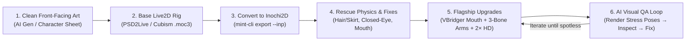

# How to Make a 60 FPS Inochi2D VTuber Puppet with AI Agents (The Easy Way)

Building a flagship 2.5D VTuber rig from scratch normally takes weeks of manual PSD cutting and Live2D Cubism tweaking. We built **Hikari** (`v1` → `v28` → **Hikari Studio**) using AI coding agents (**Codex, Claude, Antigravity**), image generation, **Live2D → Inochi2D conversion (`MINT`)**, and Python scripts — and distilled every hard-won lesson into this guide and a drop-in AI Skill.

> **Want an AI agent to do the heavy lifting for you?**
> Copy [`skills/inochi2d-puppet-builder/SKILL.md`](../skills/inochi2d-puppet-builder/SKILL.md) into **Codex CLI, Claude Code, Antigravity, or Cursor** and tell it which path below you're starting from!

---

## Pick Your Easiest Starting Path

### Path A — Fastest (5 Minutes): Reskin Hikari's Ready-Made Rig
Already want a custom character live in Hikari Studio with zero rigging work?
1. Launch Hikari Studio (`python server.py` or `hikari-desktop.exe`) and open **Settings → Look & Props**.
2. Drop in **any `.vrm` file** to automatically extract its high-res **EyeIris + EyeHighlight** onto the 2.5D puppet (`core/customizer.py` centers them symmetrically so there's zero lazy-eye!).
3. Use the live **Hair Color Picker**, **Bangs Mode**, **Skin-Safe Outfit Tint** (recolors fabric without tinting skin), or swap wardrobe PNGs in `assets/wardrobe/`.
4. Hikari Studio rebuilds `models/Hikari-v28-Custom.inp` and hot-reloads the GPU engine in **< 0.6 seconds**.

---

### Path B — What We Actually Did: AI Art / Live2D (`.moc3`) → Inochi2D (`.inp`)
If you're bringing your **own brand-new character** (or already have a **Live2D `.moc3` model** from Cubism or PSD2Live), this is the exact pipeline we used to build Hikari:



#### Step 1 — Start With a Clean Character Base
- Generate a symmetrical, front-facing anime portrait in neutral T/A-pose with flat cel lighting, eyes open, neutral mouth, and solid background.
- Auto-rig it into a Live2D `.moc3` package (e.g., PSD2Live / Live2D Cubism) — OR grab any existing Live2D `.moc3` + `.model3.json` + `.cdi3.json` model you own.

#### Step 2 — Convert Live2D `.moc3` → Native Inochi2D `.inp` Using MINT
Run **[MINT](https://github.com/Inochi2D/mint)** (`mint-cli.exe`):
```bash
mint-cli.exe export path/to/model.moc3 path/to/output --inp
```
**Two MINT Gotchas That Save Hours:**
1. **Filename stem match:** `mint-cli` requires `<stem>.model3.json` to have the **exact same filename stem** as `<stem>.moc3`. Copy to a temp folder and rename before exporting.
2. **Dropped physics:** MINT often strips Cubism physics deform bindings (leaving hair and skirt stiff). Restore/inject `Front hair`, `Back hair`, `Ahoge`, `Skirt`, `Eye bounce`, `Brow spring`, `Mouth spring`, and `Arm swing` deform bindings directly into the `.inp` JSON `param` array — and verify the `Angle` (Head X/Y) parameter keeps its mouth `deform` bindings so the mouth never detaches during head turns!

#### Step 3 — Upgrade the `.inp` Programmatically in Python
Because `.inp` is an open binary format (`TRNSRTS\0` + UTF-8 JSON scene graph + `TEX_SECT` PNG array), Codex / Claude / Antigravity can upgrade the puppet cleanly in Python without touching a GUI:

1. **Premultiplied Alpha HD Upscaling (`core/texture_upscaler.py`):**
   - **Golden Rule:** Inochi2D OpenGL requires **premultiplied alpha PNGs** (`RGB = RGB_straight * Alpha`). Always un-premultiply before color grading or 2× anime lineart upscaling, smooth silhouette alpha edges, then re-premultiply — otherwise bright hair & lashes get ugly black halos!
2. **Closed-Eye & Blink Polish:**
   - Clean stray iris/lash alpha bleed when `EyeOpen = 0`, and damp eye-bounce springs (`damping >= 0.78`, clamp `<= ±0.22`) so blinks feel crisp and natural instead of jiggly.
3. **6-Layer Stencil-Masked VBridger Mouth (No Choppy Sprite Swaps!):**
   - Replace flat swapped mouth PNGs with a 6-layer OpenGL stencil-masked geometric mouth (cavity mask, tongue, upper/lower teeth, smooth 11-point curved lips) bound to 8 VTS/VBridger parameters (`jawOpen`, `mouthOpen`, `mouthForm`, `mouthFunnel`, `lipsPress`, `mouthShrug`, `mouthX`, `tongueOut`) driven by our `0.28 ms/frame` 12-MFCC + IPA Formant lip-sync engine (`modules/lipsync.py`).
4. **True 3-Bone Rigid Toggle Arms (Solving "Spaghetti Fingers"):**
   - Single-mesh deformers turn waving hands into rubber past 45°. Instead, generate one lighting-matched waving arm reference, slice it into 3 circular-capped parts (`Upper Arm`, `Forearm`, `Hand` — see `assets/hd_parts/wave/`), and rig them as a **rigid 3-bone Node hierarchy** (`Shoulder → Elbow → Wrist`) rotating purely via `transform.r.z` + spring follow-through. Result: **zero finger distortion at any angle**.
5. **Drop Into Hikari Studio & Run the Visual QA Loop:**
   - Render your new `.inp` through `engine/hikari-live-engine.exe` across a stress pose grid (**Neutral, Head Yaw `±15°`, Full Blink, `A/I/U/E/O` Vowels, Wave Peak, Shader ON & Shader OFF**).
   - Have your multimodal AI agent read the captured frames, spot any halo/seam/gaze flaw, patch the Python builder, and re-verify until every frame is clean.

---

### Path C — Building From Scratch in Inochi Creator
If you're drawing a brand-new layered PSD from scratch:
1. Separate layers back-to-front (back hair → body/outfit → neck → face/blush → sclera/irises/lashes/brows → 6-layer mouth → front hair/ahoge → toggle arms).
2. Import the PSD into **Inochi Creator**, mesh & bind basic head/eye parameters, and export `.inp`.
3. Hand the `.inp` to your AI agent with [`skills/inochi2d-puppet-builder/SKILL.md`](../skills/inochi2d-puppet-builder/SKILL.md) to run the HD premultiplied upscale, VRM eye transfer, 3-bone wave arms, and automated visual QA loop!
