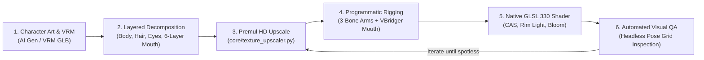

# How We Built & Curated a 60 FPS Inochi2D VTuber with AI Agents

Most 2.5D VTuber rigs take weeks of manual PSD cutting and Live2D Cubism tweaking. **Hikari** was engineered through an iterative, fully reproducible **AI-assisted Inochi2D (`.inp`) pipeline** using **Codex, Claude, Antigravity, image generation, Python, and a custom native DLang OpenGL renderer**.

This guide walks through the exact workflow so you can curate, upgrade, or build your own Inochi2D puppet — or drop our portable agent skill ([`skills/inochi2d-puppet-builder/SKILL.md`](../skills/inochi2d-puppet-builder/SKILL.md)) straight into Codex, Claude Code, Antigravity, or Cursor.

---

## Why Inochi2D (`.inp`) Instead of Live2D?

1. **100% Open Binary Format:** `.inp` is just a `TRNSRTS\0` header + UTF-8 JSON scene graph + `TEX_SECT` PNG texture array. Coding agents can read, diff, script, and rebuild the entire rig in **< 0.6 seconds** in Python (`core/customizer.py`, `core/texture_upscaler.py`).
2. **Native GPU Speed:** Our custom DLang OpenGL 3.2 renderer (`engine/source/app.d`) runs at a locked **60 FPS** using **~1.6% CPU** with zero-copy FBO post-processing (Contrast-Adaptive Sharpening, dual rim-light, selective bloom, room light-wrap).
3. **Zero Proprietary Lock-In:** Every texture, mesh UV, bone hierarchy, mask, and spring physics parameter lives cleanly in versionable scripts.

---

## The 6-Stage AI Curation Pipeline



### Stage 1 — Establish the Visual Anchor (Character Sheet + VRM Eyes)
- Start with a crisp, symmetrical front-facing anime portrait in neutral lighting.
- If you already have a 3D `.vrm` avatar (GLB 2.0), you can automatically harvest its exact **EyeIris** and **EyeHighlight** textures (`core/customizer.py:extract_vrm_eye_assets`) so the 2.5D puppet shares the exact same soul and eye sparkle as the 3D model.

### Stage 2 — Unpack `.inp` & Respect Premultiplied Alpha
Every Inochi2D texture in `TEX_SECT` uses **premultiplied alpha** (`RGB = RGB_straight * Alpha`).
- **Golden rule:** Always un-premultiply before running any OpenCV/PIL color grading, HSV hair/outfit tinting, or upscaling, then re-premultiply before packing back into `.inp`.
- Skipping this causes ugly dark outlines around bright anime hair and eyelashes.

### Stage 3 — Non-Destructive HD Upscaling & Skin-Safe Wardrobe
- In `core/texture_upscaler.py`, raw textures are un-premultiplied, upscaled 2× with anime lineart preservation, silhouette-feathered (`smooth_premul_silhouette_png`), and re-packed into `models/Hikari-v28-BaseHD-v5.inp`.
- For live outfit recoloring (`core/customizer.py`) and wardrobe swaps (`core/wardrobe.py`), we mask out skin HSV bands before applying fabric tints so neck, collarbone, and midriff skin tones never bleed red or purple.

### Stage 4 — 3-Bone Rigid Toggle Arms (Solving "Spaghetti Fingers")
Classic 2D mesh deformers bend hands and fingers like rubber during big gestures. To get crisp Hololive-tier waves and cheers:
1. Generate a waving arm pose matched to the puppet's exact lighting and camera projection.
2. Segment it cleanly into three overlapping circular-capped parts (`assets/hd_parts/wave/`): **Upper Arm** (feathered deltoid behind topwear), **Forearm**, and **Hand**.
3. Wire them as a **true 3-bone rigid Inochi2D Node hierarchy** (`Shoulder → Elbow → Wrist`), driving only rigid `transform.r.z` rotations + spring follow-through. Result: **zero finger distortion at any angle**.

### Stage 5 — 8-Parameter VBridger Mouth & 4-Engine Lip-Sync
Instead of a simple 1-slider mouth flap, Hikari binds a **6-layer stencil-masked mouth** (cavity, tongue, upper/lower teeth, lips, mask) to an 8-parameter VTS/VBridger mapper (`core/rig_controller.py`):
- Driven in real time by `modules/lipsync.py`: **Hybrid (12-MFCC + IPA F1/F2 Formants)** at `0.28 ms/frame`, plus per-voice **vowel calibration** (`AA, EE, IH, OH, OU, MBP`).
- Layered with our **Neuro-style Procedural Idle Choreographer** (`curious_tilt`, `vibe_sway`, `happy_bounce`, `chat_read`, `daydream_sigh`, `cheeky_lean`) and 15 spring-tweened emotes.

### Stage 6 — The Agentic Visual QA Loop
The secret to getting production-grade 2.5D art out of coding agents (Codex / Claude / Antigravity) is **closing the visual loop**:
1. Script the `.inp` change in Python.
2. Render the live puppet via `hikari-live-engine.exe` across stress poses (yaw `±15°`, full blink, `A/I/U/E/O` vowels, arm wave peak, shader ON & OFF).
3. Have the multimodal agent **read the rendered frames directly**, spot alpha halos / seam gaps / gaze offsets, patch the generator script, and re-verify.

---

## Using the Built-In AI Skill

Want your own coding agent to follow this exact playbook automatically? Point it at:

```text
skills/inochi2d-puppet-builder/SKILL.md
```

- **Codex / Claude Code / Antigravity / Cursor:** Copy `skills/inochi2d-puppet-builder/` into your workspace or global skills folder, then ask your agent:
  > *"Use the `inochi2d-puppet-builder` skill to inspect my `.inp` puppet, upscale the hair/face textures with premultiplied alpha matting, extract eyes from my `.vrm`, and visually verify neutral + blink + wave poses."*
